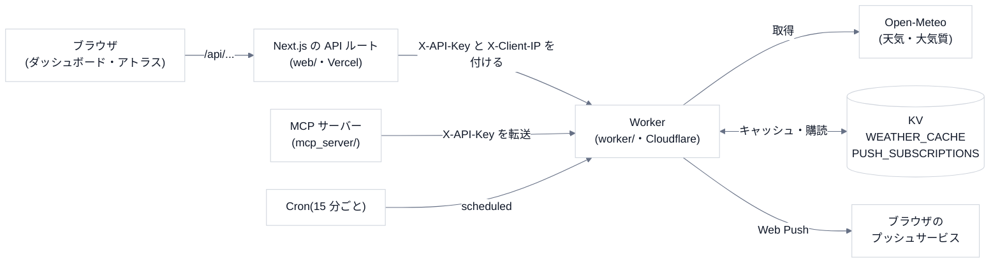

# 1. 全体像

## 3 つの部品と、1 つの外部サービス

- **Worker** が中心。天気の取得・キャッシュ・通知の判定をする(TypeScript・Hono)。
- **Next.js** は、ブラウザと Worker の間に入る。**API キーをブラウザに渡さない**ため(キーはサーバー側だけが持つ)。
- **MCP サーバー**(Python)は、Worker を呼ぶだけの薄いクライアント。判断(傘・洗濯)のルールだけを自前で持つ。
- 天気のデータは **Open-Meteo**(無料枠)。この資料の範囲では、Open-Meteo の側は変えられない。

## エンドポイント

| メソッド・パス | 認証 | 返すもの | キャッシュ |
|---|---|---|---|
| `GET /health` | 不要 | 生存確認 | なし |
| `GET /api/push/vapid-public-key` | 不要 | Web Push の公開鍵 | なし |
| `GET /api/weather` | 要 | いまの観測(`lat`・`lon`) | **使える 10 分**(KV) |
| `GET /api/weather/forecast` | 要 | 日ごと+時間ごとの予報(`days` 1〜16、既定 3) | なし |
| `GET /api/air-quality` | 要 | 大気質 | なし |
| `GET /api/weather/history` | 要 | 過去との比較 | なし |
| `GET /api/weather/series` | 要 | 複数地点(`points=lat,lon;…` 最大 40)の +72 時間・3 時間刻み | **新鮮 30 分**(保存 2 時間) |
| `GET /api/weather/grid` | 要 | 中心+範囲(`span` 0.4〜6 度・`n` 4〜10)のメッシュ | series と同じ |
| `POST /api/push/subscribe` | 要 | 購読の登録(`201`) | – |

`要` のものには、**認証 → レート制限 → 入力の検証** の順で、どれかに落ちたらそこで返ります(→ [内側のしくみ](03-internals.md))。

## データの置き場所

| 置き場所 | 中身 | 期限 |
|---|---|---|
| KV `WEATHER_CACHE` | `weather:緯度,経度`(小数 2 桁)の観測+`fetchedAt` | 保存 **7 日**(使える期限は 10 分) |
| KV `WEATHER_CACHE` | `series:<SHA-256>`(地点リストの丸めた座標から)の系列 | 保存 **2 時間**(新鮮は 30 分) |
| KV `PUSH_SUBSCRIPTIONS` | `push:<SHA-256(endpoint)>` の購読(endpoint・鍵・通知の条件・**地点**) | 期限なし(無効になったら通知時に削除) |

DB は無く、**Worker はほぼ状態を持ちません**。持つ状態は KV の 2 つだけです。

## 設定値

| 名前 | 種類 | 役割 |
|---|---|---|
| `WEATHERGEOBRIDGE_API_KEY` | シークレット | `X-API-Key` の正解。**未設定だと全拒否**(503) |
| `ALLOW_UNAUTHENTICATED` | 開発用 | `true` のときだけ、鍵なしで通す(`.dev.vars`) |
| `VAPID_PRIVATE_KEY` | シークレット | Web Push の署名。未設定なら通知をスキップ |
| `VAPID_PUBLIC_KEY`・`VAPID_SUBJECT` | `wrangler.jsonc` の `vars` | 公開鍵・連絡先(URL) |
| `ALLOWED_ORIGINS` | `vars` | CORS を許すオリジン(カンマ区切り)。**未設定なら全拒否** |
| `RATE_LIMITER` | `ratelimits` | 利用者ごとに 1 分 60 回 |
| `crons` | `triggers` | `*/15 * * * *`(15 分ごと) |

MCP 側は、環境変数 `WEATHERGEOBRIDGE_WORKER_URL`(既定 `http://localhost:8788`)で Worker の場所を決めます。Next.js 側は `WEATHERGEOBRIDGE_API_BASE_URL`・`WEATHERGEOBRIDGE_API_KEY`(`web/lib/backend.ts`)。

## やらないこと(範囲の外)

- **予報そのものの精度は、Open-Meteo 次第**。判断(傘・洗濯)は「予報があたる」保証ではない(`basis` に書いてある)。
- 地点の検索(ジオコーディング)は `web/app/api/geocode/` にあり、Worker は持たない。
- ユーザーの登録・ログインは無い。購読は**ブラウザのプッシュ endpoint** が識別子。
